# Timeline Tools silver theme

The page canvas is silver on all routes. Slate primary buttons, copper selections and a light native audio player share the same palette as the full-page editor and Admin CMS. Layout, copy, auth, APIs, audio processing and workers are unchanged.

`public/theme.js` is the single colour source: the root layout emits its CSS variables before content renders; canvas components and the module painter import the same values. Existing CSS names alias the new semantic tokens. First-party runtime UI files contain no colour hex literals outside this file. Historical prototype files, database migrations, worker-produced arrangement metadata and test fixture data are retained; bright saved/custom track hues are darkened only when displayed, without changing stored projects.

## Contrast adjustments

The requested base silver, surface, primary, copper and status colours are retained. Muted text changes slightly; additional role-specific shades allow text and interactive boundaries to meet AA. Base border is decorative; controls use the stronger border. Copper fills use dark text, never white.

| Role | Requested base | Accessible use | Contrast on page silver |
| --- | --- | --- | --- |
| Primary text | `#1E2427` | unchanged | 7.95:1 |
| Muted text | `#4A5458` | `#424B4F` | 4.52:1 |
| Copper text | `#C2783B` | `#6F3B16` | 4.60:1 |
| Focus / playhead / active indicator | `#C2783B` | `#8A4B1E` | 3.42:1 |
| Success text | `#2E7D4F` | `#1D5233` | 4.61:1 |
| Danger text | `#B23A3A` | `#852727` | 4.59:1 |
| Warning text | `#B7841F` | `#604307` | 4.62:1 |
| Control border | `#8E979A` | `#586366` | 3.14:1 |

White on primary is 11.86:1; white on primary hover is 8.81:1; dark text on a copper selection is 4.52:1. Track coding uses darker slate, violet, green, gold, rose and teal headers/edges. Clip bodies are slate with light waveforms, or copper with dark waveforms when selected. The glass tube retains its curved reflections, liquid animation, pause/reduced-motion behavior, green success and red failure states.

## Before / after

Baseline: main at `920f192`. Isolated local API/auth fixture, identical content, reduced motion, desktop 1440×1000 and mobile 390×844. Editor screenshots include a generated four-second audio clip. Mobile editor framing follows the existing desktop-oriented layout.

| Route | Desktop before | Desktop after | Mobile before | Mobile after |
| --- | --- | --- | --- | --- |
| `/` | 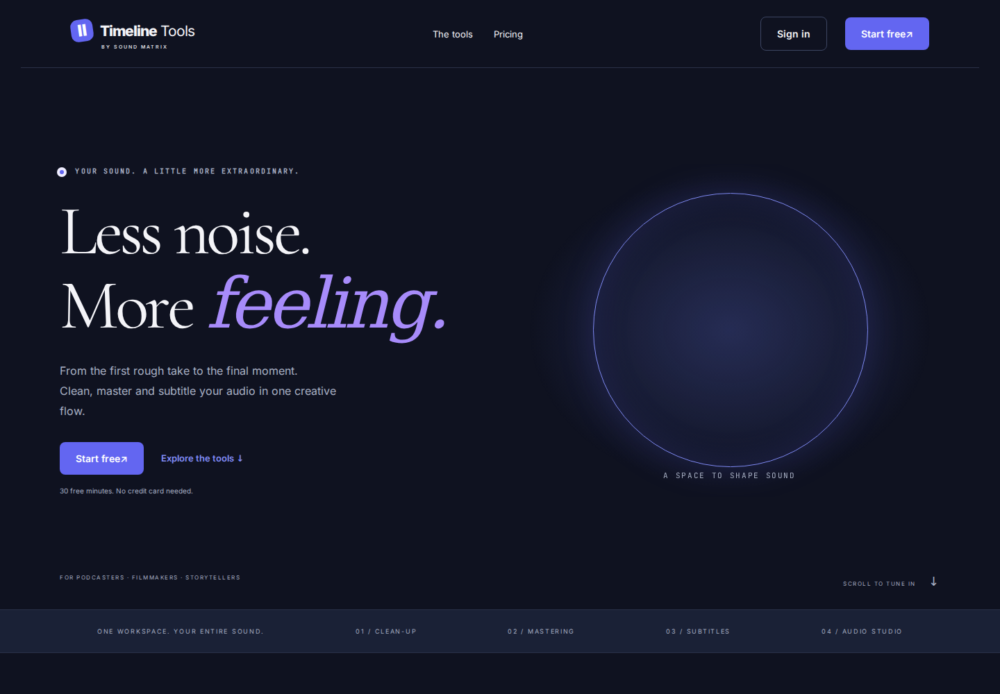 | 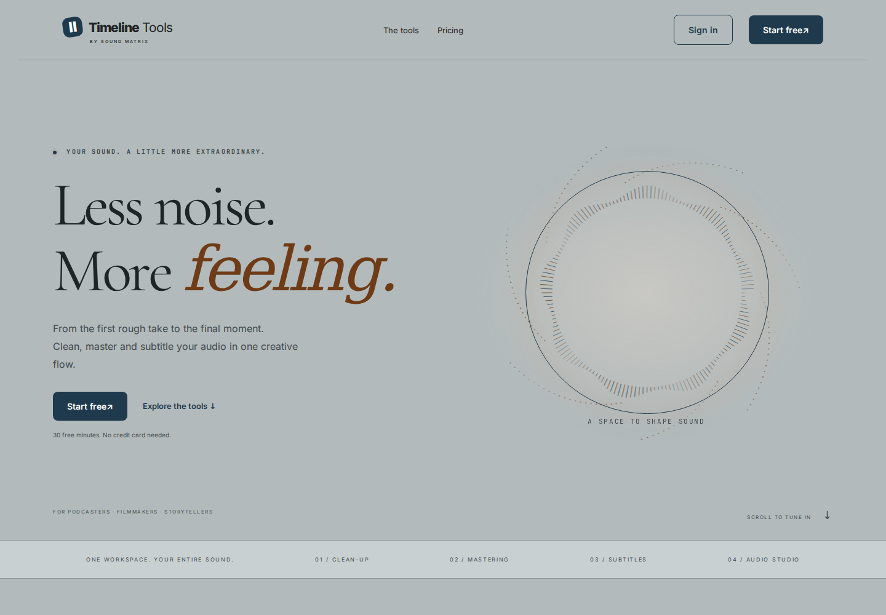 | 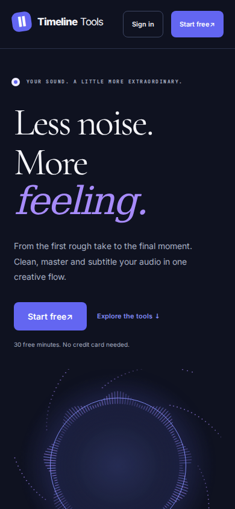 | 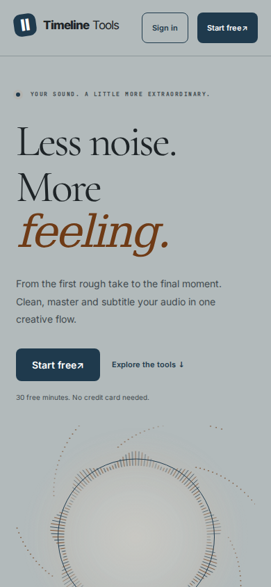 |
| `/studio` | 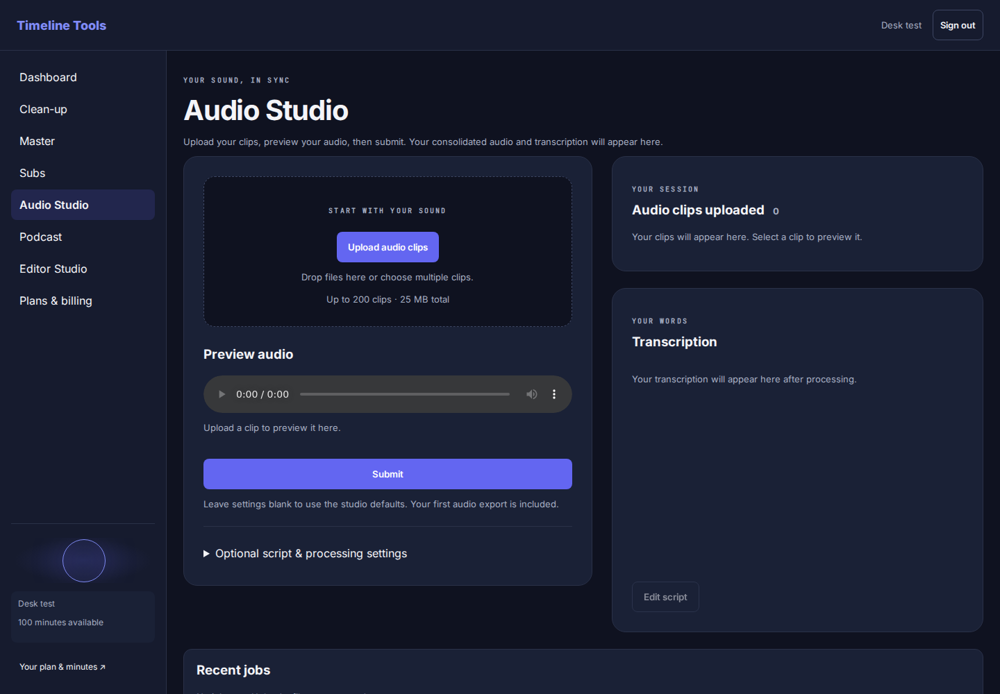 | 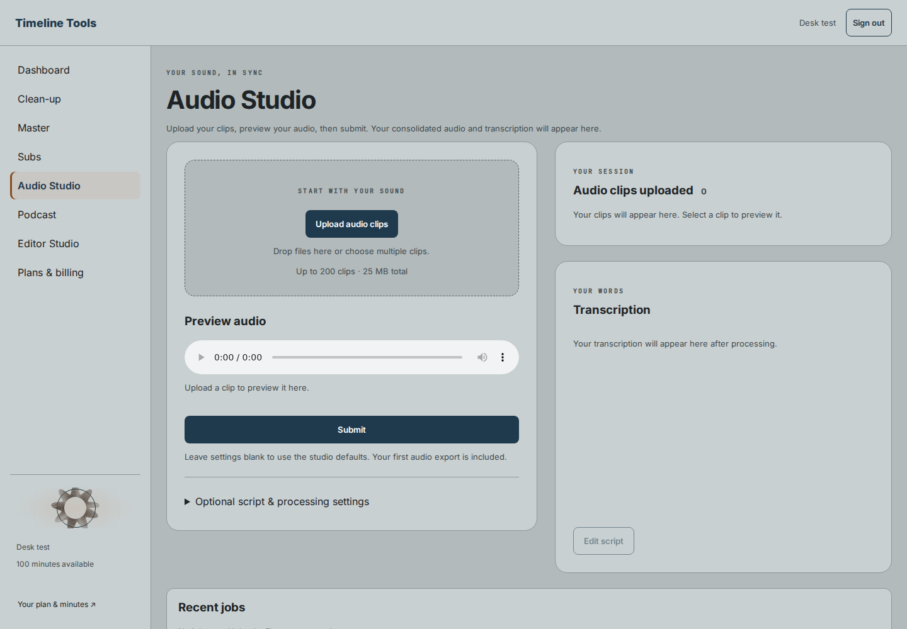 | 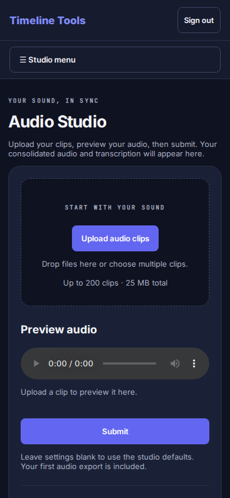 | 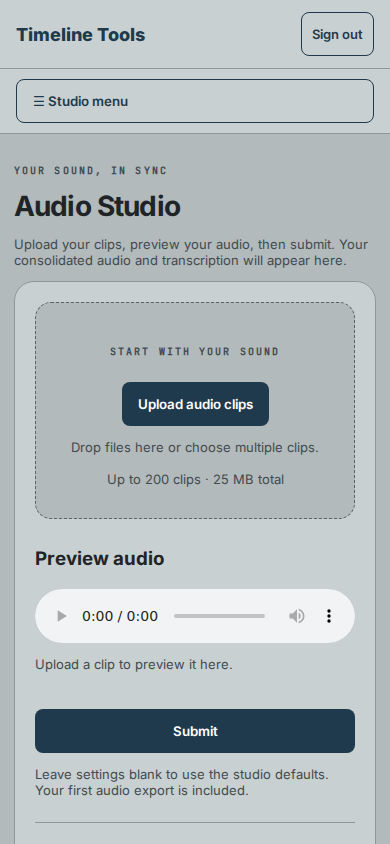 |
| Editor Studio | 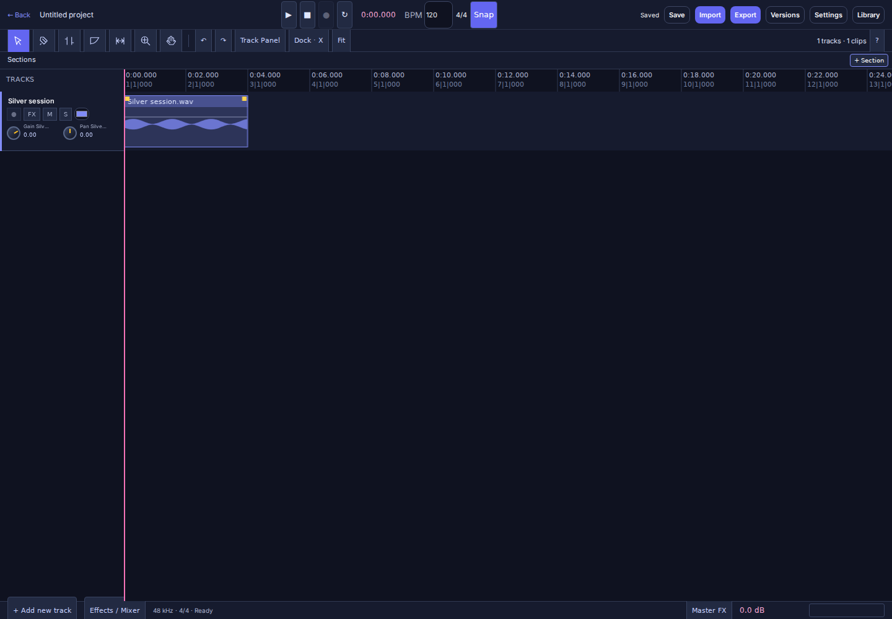 | 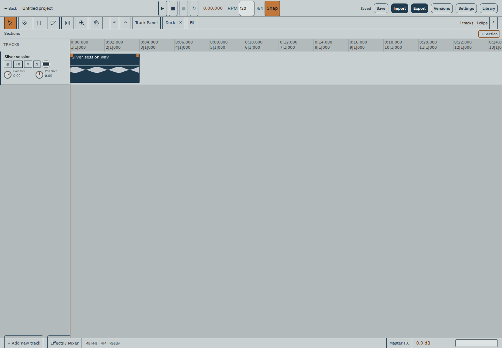 | 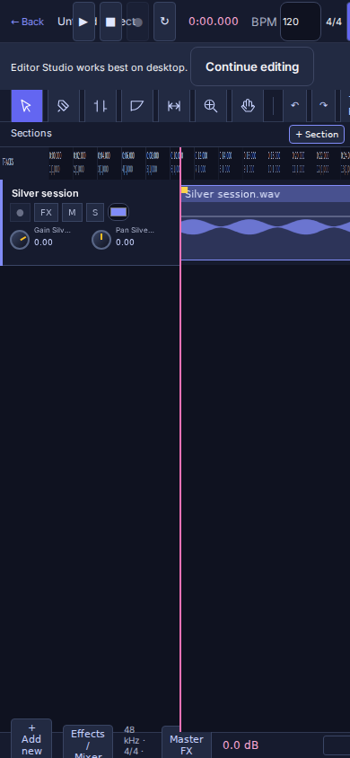 | 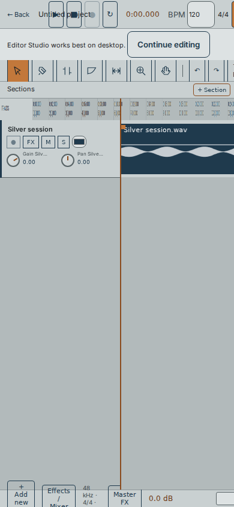 |
| `/admin` | 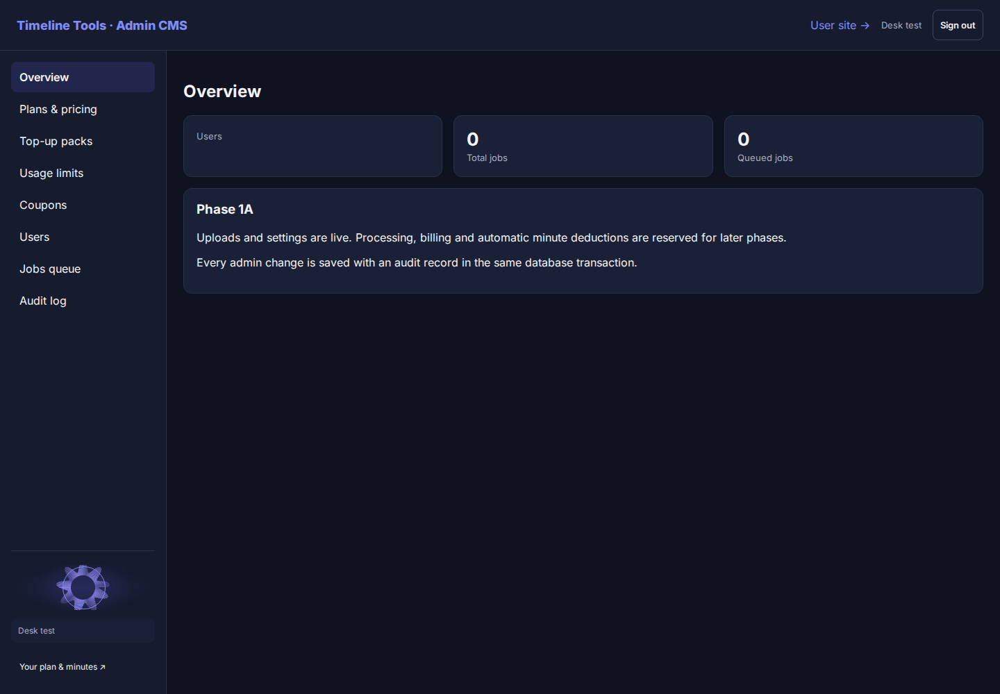 | 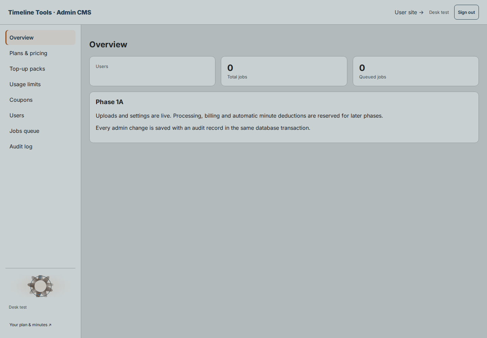 | 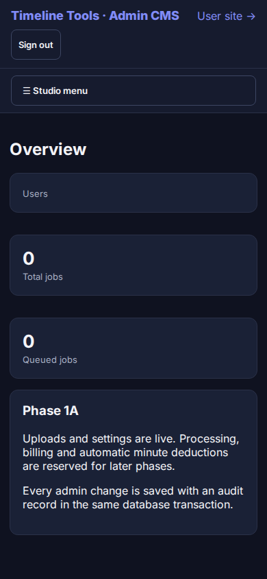 | 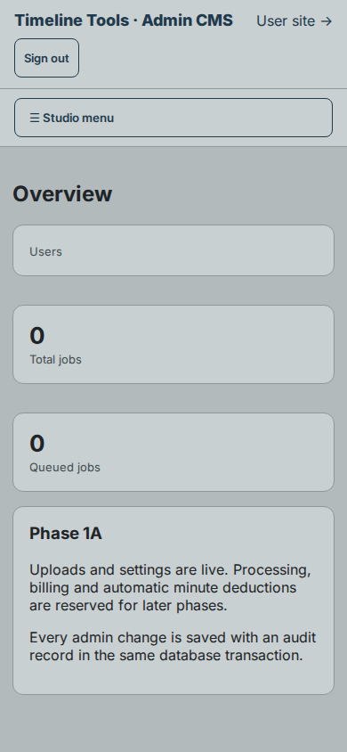 |

[Selected clip](after/editor-selected.png)

## Verification

- Production build and TypeScript checks.
- `npm test`: 218 passing, including semantic text/UI contrast and a guard against scattered runtime colour literals.
- Full Chromium desk run: 36/38 passed initially. The audio parity test passed after installing the missing local `soundfile` dependency. The remaining native video timing test also fails unchanged main at `920f192` in this container (baseline p95 106.6 ms vs 66.7 ms limit; themed run 70.1 ms). No timing thresholds, audio/video logic or tests were loosened.
- Browser route/screenshot coverage in `tests/browser/silver-theme.spec.ts`, using `playwright.desk.config.ts`. Includes auth pages and the other workplace routes.
- axe-core 4.14.0 rendered `color-contrast` audit: zero violations across the 13 pages in [contrast-audit.json](contrast-audit.json). Canvas colours are checked separately against the same semantic palette; decorative glass/visualizer translucency is not body text.

To recapture against a fixture build:

```sh
NEXT_PUBLIC_SUPABASE_URL=http://127.0.0.1:54331 NEXT_PUBLIC_SUPABASE_ANON_KEY=desk-test-key npm run build
npx playwright test --config playwright.desk.config.ts silver-theme.spec.ts
```

Use `THEME_SCREENSHOT_PHASE=before` with the baseline build to capture the matching baseline frames.
